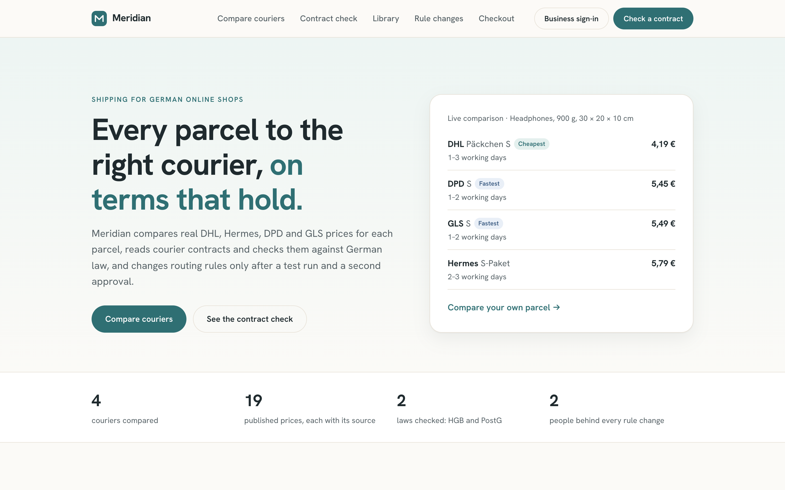

# Meridian

Meridian helps German online shops:
- compare courier services and manage delivery rules. 
- checks courier contracts against relevant German freight and postal law
- routing changes possible. but it require a test run and a second person's approval.
- a local AI language model can help interpret contract clauses - deterministic checks remain in control.




## How to run

Requires Java 21 and Node 24. 

- Backend app

```bash
./gradlew bootRun
```

- Web App

```bash
cd web && npm ci && npm run dev
```

Open http://localhost:5180. 


## Architecture
- It follows layered Architecture, layered into `domain`, `application` and `adapter`. 
- Web app lives in `web/`
- Docker services in `compose.yaml`
- Prometheus and Grafana configuration in `monitoring/`